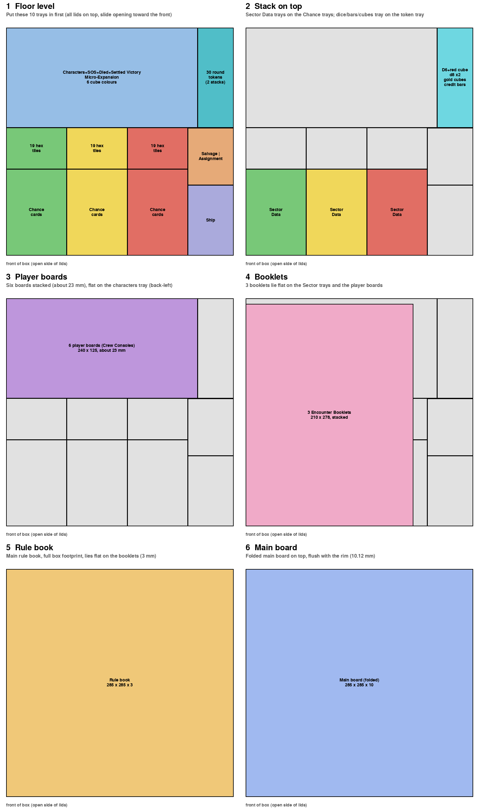

# Homestead Hyperjump insert

A 3D-printable storage insert for the board game **Homestead Hyperjump**, made with the
[Boardgame Insert Toolkit](https://github.com/dppdppd/The-Boardgame-Insert-Toolkit) (OpenSCAD).
It is an unofficial fan project. No game artwork or rules are included.

14 trays with sliding hex-pattern lids fill the 285 x 285 x 72 mm box in layers:

## Print

Download the ready-made STLs from `preview/site/pregen/` (one per tray). Chance, Sector Data and hex
trays are identical in all three colours, so print them in whatever filament you like.

Tested on a Bambu Lab P2S (256 x 256 mm plate): tolerance 0.15, wall 2, pad 0.5, 0.2 mm layers.
The largest tray (characters) is 240 x 251 mm.

| Tray | Holds |
|---|---|
| chance_* | Chance cards |
| sector_* | Sector Data cards |
| hex_* | 19 hex tiles per colour |
| characters | Character cards, SOS, Died/Android, Micro-Expansion, 6 colours of cubes |
| misc_tokens | 30 round tokens |
| misc_top | D6, red cube, 2 d8, gold cubes, credit bars |
| cards_small | Salvage and Assignment cards |
| ship | assembled ship |

## Labelled variant (untested)

`preview/site/pregen_labels/` has the same 14 trays with the name of the contents engraved on every lid
(a solid band across the hex pattern) and on every well floor. This variant has not been printed yet; the plain
trays above are the tested ones. Browse it in the viewer with `?labels=1`, or render it yourself with `-D labels=true`.

## Rebuild

`homestead_hyperjump.scad` is the design (all measurements are at the top).
`preview/pregen.sh` renders every tray with OpenSCAD (nightly build), `preview/layout.py` checks that
everything fits in the box, `preview/fill.py` redraws the fill-order picture.
Measured on my copy of the game; check the numbers against yours before printing.

## License

[CC BY-NC-SA 4.0](../../LICENSE), same as the Boardgame Insert Toolkit library in `lib/`.
